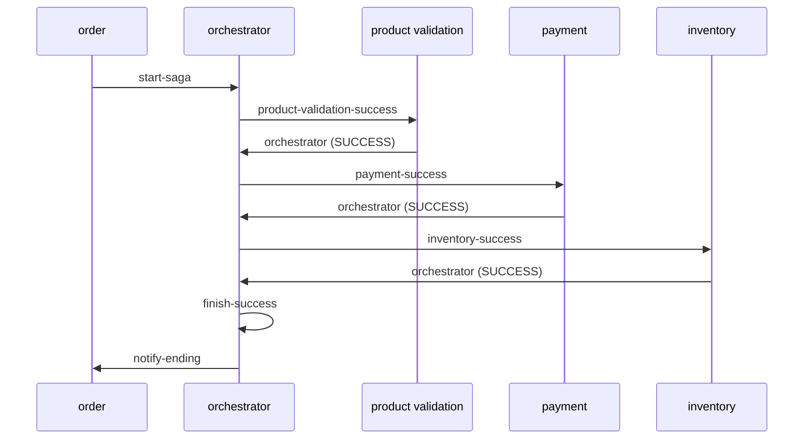
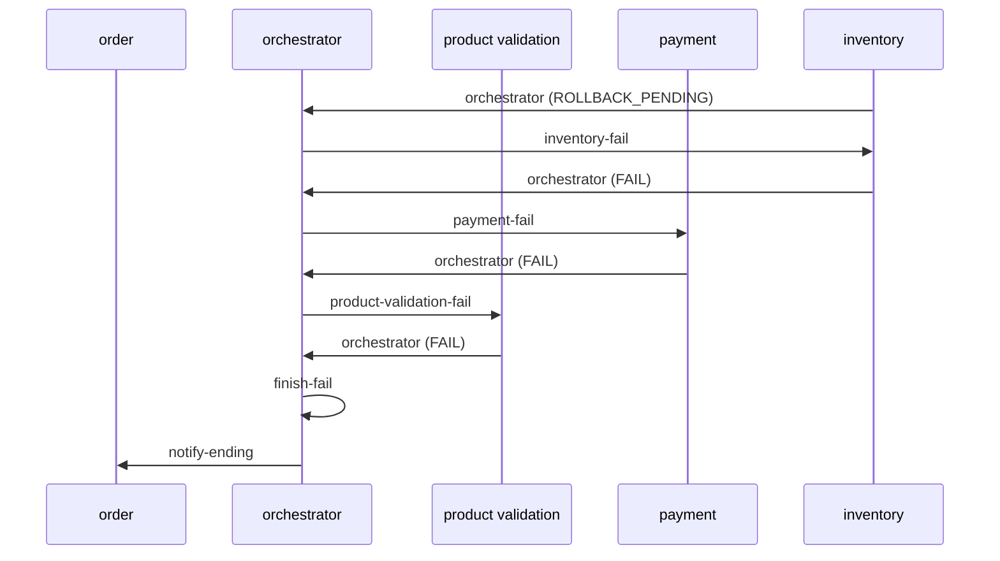

# Orchestrated Saga with Kafka

I wanted to understand how a transaction holds together when it spans several services and there's no single database to roll back. This repo is my take on the orchestrated saga pattern. An order goes through a chain of services, each one does its part, and a central orchestrator decides what happens next. If a step fails, the steps that already ran undo their work.

It's Java 17 and Spring Boot 3, with Kafka in the middle, MongoDB for orders and Postgres for the rest.

## Where it stands

This is a work in progress, and I'd rather say that up front.

| Service | State |
|---|---|
| `order-service` | Done. Creates orders, starts the saga, stores events and serves them over REST. |
| `orchestrator-service` | Topics, events and statuses are in place. Its listeners only log what they receive for now, so it doesn't route events to the next step yet. |
| `product-validation-service` | Done, rollback included. |
| `payment-service` | Listens on its topics and logs. No payment logic yet. |
| `inventory-service` | Same as payment. |

So today, when you create an order, it's saved in Mongo, an event goes to `start-saga`, the orchestrator logs it, and that's where it stops. The product validation step works on its own if you hand it an event yourself. I show how further down.

## The services

| Service | Port | Database | What it does |
|---|---|---|---|
| `order-service` | 3000 | MongoDB | REST entry point. Saves the order and its first event, then publishes to `start-saga`. Listens on `notify-ending` to save the final event. |
| `orchestrator-service` | 8080 | none | Runs the saga. Listens on `start-saga`, `orchestrator`, `finish-success` and `finish-fail`. |
| `product-validation-service` | 8090 | Postgres | Checks that every product code in the order exists. Starts with four products: `COMIC_BOOKS`, `BOOKS`, `MOVIES`, `MUSIC`. |
| `payment-service` | 8091 | Postgres | Will charge the order and refund it on rollback. |
| `inventory-service` | 8092 | Postgres | Will take stock out and put it back on rollback. |

## Events and topics

Every message is the same `Event` JSON: `id`, `transactionId`, `orderId`, `payload` (the order), `source`, `status`, `eventHistory` and `createdAt`. Each service adds an entry to `eventHistory` when it handles the event, so the event ends up telling the whole story of the transaction.

There are three statuses:

- `SUCCESS`: the step did its job.
- `ROLLBACK_PENDING`: the step failed and the saga needs to unwind.
- `FAIL`: the step was rolled back.

And these topics:

| Topic | From | To |
|---|---|---|
| `start-saga` | order | orchestrator |
| `orchestrator` | each step | orchestrator |
| `product-validation-success` / `product-validation-fail` | orchestrator | product validation |
| `payment-success` / `payment-fail` | orchestrator | payment |
| `inventory-success` / `inventory-fail` | orchestrator | inventory |
| `finish-success` / `finish-fail` | orchestrator | orchestrator |
| `notify-ending` | orchestrator | order |

The naming tripped me up at first, so a note. The orchestrator sends to a service's `-success` topic to run its step, and to its `-fail` topic to undo it. The name is about which path the saga is on, not the result. Services always answer on `orchestrator`.

## How the flow is meant to work

When everything goes right:



When a step fails, it marks the event `ROLLBACK_PENDING` and reports back. The orchestrator then walks backwards, sending the event to the `-fail` topic of that step and of every step before it. Each one undoes its work, sets `FAIL` and reports back. When nothing is left to undo, the saga ends on `finish-fail` and the order service gets the final event.

Here's inventory failing:



Right now only the first arrow and the product validation round trips exist in code. The routing in the middle is the part I'm still writing.

### Product validation, the step that's done

On `product-validation-success` it checks that the order has products, that the event has an id and a transaction id, that this order and transaction weren't validated before, and that every product code exists. If all of that passes, it saves a validation row and marks the event `SUCCESS`. If anything fails, it marks the event `ROLLBACK_PENDING` with the reason in the history.

On `product-validation-fail` it flips the validation row to unsuccessful (or creates one if there wasn't any), marks the event `FAIL` and adds a history entry saying the rollback ran.

Either way, the event goes back to the `orchestrator` topic.

## Running it

You need Docker, JDK 17 and Python 3.

```bash
python build.py
```

The script builds the five services with Gradle in parallel (skipping tests), runs `docker compose down` and then `docker compose up --build -d`.

Heads up: between those two steps it also stops and prunes every container still on your machine, not just the ones from this project. If you have other containers you care about, build by hand instead:

```bash
for app in order-service orchestrator-service product-validation-service payment-service inventory-service; do (cd $app && ./gradlew build -x test); done
docker compose up --build -d
```

Once it's up:

| What | Where |
|---|---|
| Order API | http://localhost:3000 (Swagger UI at `/swagger-ui.html`) |
| Orchestrator | http://localhost:8080 |
| Product validation | http://localhost:8090 |
| Payment | http://localhost:8091 |
| Inventory | http://localhost:8092 |
| Redpanda Console | http://localhost:8081 |
| Kafka | localhost:9092 |
| MongoDB | localhost:27017 |
| Postgres (product, payment, inventory) | localhost:5432, 5433, 5434 |

## Watching a saga

Create an order:

```bash
curl -X POST http://localhost:3000/api/v1/order \
  -H "Content-Type: application/json" \
  -d '{"products":[{"product":{"code":"COMIC_BOOKS","unitValue":15.5},"quantity":3},{"product":{"code":"BOOKS","unitValue":9.9},"quantity":1}]}'
```

You get the saved order back, with its `id` and a `transactionId` that looks like `<epoch millis>_<uuid>`. Then:

- Open Redpanda Console at http://localhost:8081 and look at the `start-saga` topic. Your event is there.
- Run `docker logs -f orchestrator-service` to see the orchestrator pick it up.
- `GET http://localhost:3000/api/v1/event` lists every event, newest first.
- `GET http://localhost:3000/api/v1/event/search?orderId=<id>` (or `?transactionId=<id>`) returns the latest event for that order.

### Playing orchestrator by hand

Since the orchestrator doesn't forward events yet, you can do its job. Copy the event JSON from `start-saga` in Redpanda Console and produce it to `product-validation-success`. Product validation picks it up and its answer shows up on the `orchestrator` topic.

A few things worth trying:

- Change a product code to something like `GAMES` and you get `ROLLBACK_PENDING`.
- Send the same event twice and the second one fails as a duplicate.
- Send an event to `product-validation-fail` and you see the rollback with status `FAIL`.

## What's next

- Routing in the orchestrator: read the event's source and status and pick the next topic.
- Payment: work out the total, save the payment, refund it on rollback.
- Inventory: keep stock per product, take it out, put it back on rollback.
- Fill in `totalAmount` and `totalItems` on the order. The fields are there but nothing sets them yet.
- In `docker-compose.yml`, `payment-service` points at `product-db` instead of `payment-db`. It doesn't break anything yet because payment has no tables, but it needs fixing before payment gets real logic.
